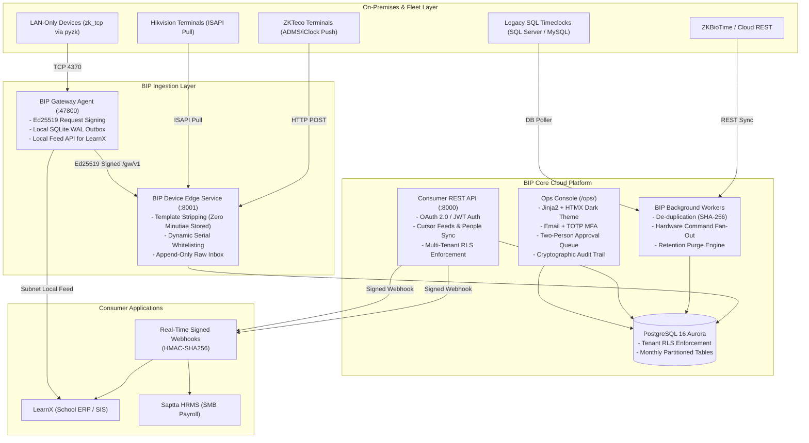

# Biometric Integration Platform (BIP)

A high-throughput, multi-tenant biometric middleware connecting heterogeneous biometric attendance hardware fleets (ZKTeco ADMS, Hikvision ISAPI, Matrix COSEC, SQL databases, CSV/Excel imports) to consumer applications (LearnX, Saptta HRMS, and enterprise SIS platforms).



---

## Key Features

1. **Four Ingestion Modes:**
   - **Device Push (Default):** Terminals stream ADMS/iClock records directly to BIP Edge.
   - **Vendor Platform Pull:** BIP pulls from ZKBioTime 8.5/Cloud or Matrix COSEC.
   - **Edge Gateway Agent:** Lightweight Python service on on-premise Windows/Linux/Raspberry Pi reaches LAN-only terminals with an offline-resilient SQLite outbox.
   - **File Import:** CSV and XLSX punch parser with fuzzy column mapping and validation reporting.
2. **Zero Biometric Cloud Storage:** Raw biometric templates (`TMP`, `FACE`, minutiae) are intercepted and dropped at the Edge before persistence. Only `(pin, timestamp, device_id, in_out)` is retained.
3. **Multi-Tenant Row-Level Security (RLS):** Strict PostgreSQL RLS policies enforce isolation between partner institutions.
4. **Append-Only Cryptographic Audit Trail:** Ops console actions are chained with SHA-256 hashes for non-repudiation and tamper detection.
5. **Two-Person Approval Rule:** Destructive actions (such as gateway revocation) require dual administrative approval.
6. **2,000-Device Scale:** Benchmark tested with 2,000 active devices: Edge response **p95 = 3.05 ms** (spec: < 200 ms) and ingest lag **p95 = 0.003 s** (spec: < 60 s).

---

## Quick Start

### 1. Local Environment Setup

```bash
# 1. Clone repository and set up virtual environment
python -m venv .venv
.venv\Scripts\activate   # On Windows
# source .venv/bin/activate # On Linux/macOS

# 2. Install dependencies
pip install -e ".[dev]"
```

### 2. Run All Automated Tests

```bash
# Run unit test suite (199 passing tests)
pytest tests/unit -v

# Run lint and format check
ruff check src/ tests/
ruff format --check src/ tests/
```

### 3. Run the 2,000-Device Load Test

```bash
python scripts/loadtest_2000_devices.py --devices 2000 --punches 5 --concurrency 50
```

---

## Ops Console Walkthrough

BIP provides a dark-themed operational web console for platform administrators at `/ops/`:

- **MFA Security:** Email + PBKDF2-HMAC-SHA256 password authentication followed by 6-digit TOTP validation (pyotp).
- **Dashboard (`/ops/`):** Real-time fleet metrics (Partners, Orgs, Sites, Devices, Gateways, Pending Approvals) and live audit log stream.
- **Partner & Org Hierarchy (`/ops/partners`, `/ops/orgs`):** Multi-tenant organization and site management.
- **Device Fleet Management (`/ops/devices`, `/ops/gateways`):** Hardware device statuses and paired Edge Gateways.
- **Two-Person Approvals (`/ops/approvals`):** Approval queue where requests must be reviewed by a different administrator (self-approval strictly blocked).
- **Cryptographic Audit Viewer (`/ops/audit`):** Filterable audit log with SHA-256 forward links.

Default development credentials:
- **Email:** `admin@bip.internal`
- **Password:** `AdminSecurePassword123!`
- **TOTP Secret:** `JBSWY3DPEHPK3PXP` (generates standard 30s TOTP codes)

---

## Integration Guide

For detailed engineering instructions on connecting your SIS, HRMS, or custom application, refer to:

- [Developer Integration Guide](docs/INTEGRATION.md) — OAuth 2.0 auth, user synchronization, webhook signature verification (Python/Node.js), cursor polling, local feed API.
- [Connector Capabilities Matrix](docs/CAPABILITIES.md) — Full feature comparison across all 6 hardware connector adapters.
- [2,000-Device Load Test Report](docs/LOADTEST.md) — Latency percentiles, throughput, and capacity sizing.
- [OpenAPI Specification](docs/openapi.json) — Complete machine-readable OpenAPI 3.1 schema.
- [Compliance Documentation](docs/compliance/DATA_MAP.md) — GDPR/DPDP data mapping and biometric security policy.
- [Operations Runbooks](docs/runbooks/) — Disaster recovery, database maintenance, gateway triage, and secret rotation.

---

## Production Deployment (Terraform)

Deploy the complete BIP cloud infrastructure to AWS using the included Terraform skeleton in `deploy/terraform/`:

```bash
cd deploy/terraform
cp terraform.tfvars.example terraform.tfvars
# Edit terraform.tfvars with database passwords and ECR image URLs
terraform init
terraform plan
terraform apply
```

The infrastructure provisions:
- AWS VPC with public and private subnets across 2 AZs.
- Application Load Balancer with path-based routing (`/v1`, `/ops`, `/iclock`, `/gw`).
- Amazon Aurora PostgreSQL 16 Cluster (Multi-AZ, KMS Encrypted).
- Amazon S3 Raw Upload Inbox with 730-day lifecycle purge rules.
- Amazon ECS Fargate Cluster with task definitions for API, Edge, and Worker services.
